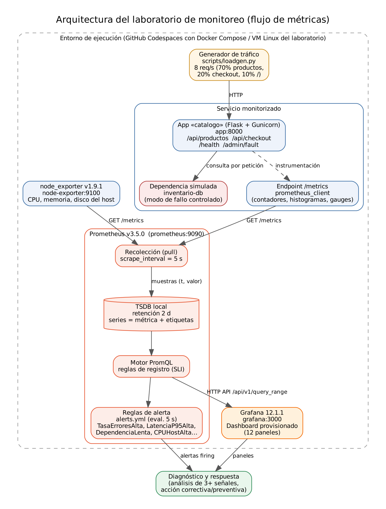

# Laboratorio – Monitoreo en la nube y gestión de métricas en bases de datos de series temporales

**Universidad Tecnológica del Perú (UTP)** · Curso: *Servicios Cloud* (sección 45104) · Laboratorio N.º 10 · Docente: Dr. Eleodoro Orbegoso Carrera
**Estudiante:** Thiago Paolo Icochea Rodriguez

Laboratorio de observabilidad con **Prometheus (recolección + TSDB) → PromQL → Grafana → reglas de alerta**, aplicado a un
incidente controlado y reversible: la dependencia interna `inventario-db` de una app de prueba se degrada (latencia alta y
errores intermitentes) y se diagnostica correlacionando series temporales.

📄 Informe: [`informe/Informe_Laboratorio_Monitoreo_Cloud.docx`](informe/Informe_Laboratorio_Monitoreo_Cloud.docx) ·
[`PDF`](informe/Informe_Laboratorio_Monitoreo_Cloud.pdf)

## Arquitectura



| Componente | Nombre lógico | Versión | Función |
|---|---|---|---|
| App de prueba «catalogo» | `app:8000` | Flask 3.1.2, prometheus-client 0.23.1, Gunicorn 23 | Servicio monitorizado; expone `/metrics` y `/admin/fault` |
| node_exporter | `node-exporter:9100` | 1.9.1 | Métricas del host (CPU, memoria, disco) |
| Prometheus | `prometheus:9090` | 3.5.0 | Recolección cada 5 s, TSDB local, PromQL, reglas |
| Grafana | `grafana:3000` | 12.1.1 | Dashboard provisionado (12 paneles) |
| Generador de tráfico | `scripts/loadgen.py` | — | 8 req/s contra la app local |

## Ejecución en GitHub Codespaces (recomendado)

1. En GitHub: **Code → Codespaces → Create codespace on main** (usa `.devcontainer/` con Docker-in-Docker; 2 núcleos, cuota gratuita).
2. En la terminal del Codespace:

```bash
export GRAFANA_ADMIN_PASSWORD='elige-una-clave'
docker compose up -d --build
bash scripts/validar_entorno.sh            # servicios, targets, reglas y Grafana
bash scripts/ejecutar_experimento.sh       # base 6 min → incidente 5 min → recuperación 6 min → exportación
python3 scripts/graficar.py                # gráficos desde los datos exportados
```

3. Abrir el puerto **3000** (Grafana, usuario `admin`) → dashboard *Catálogo – Observabilidad*; puerto **9090** para Prometheus.
4. Al terminar: `docker compose down -v` y **detener el Codespace** para no consumir cuota.

Cada fase también puede ejecutarse por separado: `ejecutar_baseline.sh`, `ejecutar_incidente.sh`, `ejecutar_recuperacion.sh`,
`exportar_metricas.sh`. El fallo se activa/desactiva con `POST /admin/fault?enable=1|0`.

## Ejecución sin Docker (modo usado para los resultados de este repositorio)

El entorno donde se ejecutó el experimento bloqueaba Docker Hub y `dl.grafana.com`, por lo que se usaron los **binarios
oficiales de Prometheus 3.5.0 y node_exporter 1.9.1** descargados de GitHub Releases:

```bash
pip install -r application/requirements.txt requests
BIN_DIR=/opt/lab bash scripts/run_local_sin_docker.sh
bash scripts/ejecutar_experimento.sh
python3 scripts/graficar.py && python3 scripts/capturas_prometheus.py
```

Grafana no pudo ejecutarse en ese entorno: su dashboard y datasource quedan **provisionados y validados como JSON/YAML**,
y se ejecutan con `docker compose up` en Codespaces. Las figuras del informe provienen de la interfaz real de Prometheus y
de gráficos generados con los datos exportados de su API (no hay capturas simuladas).

## Estructura

```
.devcontainer/devcontainer.json   Codespaces + Docker-in-Docker
docker-compose.yml                app, node-exporter, prometheus, grafana
application/                      app.py, Dockerfile, requirements.txt
prometheus/                       prometheus.yml, alerts.yml (4 reglas de registro, 6 alertas)
grafana/                          provisioning (datasource + dashboards) y dashboard JSON
scripts/                          validación, carga, fases, exportación, gráficos, capturas, informe
resultados/                       timeline, series (CSV), consultas PromQL (JSON), resumen por fase, alertas
evidencias/                       arquitectura, baseline, incidente, recuperacion, consultas, alertas
informe/                          Informe Word y PDF
```

## Resultados (ejecución real del 16/10/2026, hora de Lima)

| Indicador | Línea base (18:31:47–18:37:48) | Incidente (18:37:48–18:42:50) | Recuperación (18:42:50–18:48:50) |
|---|---|---|---|
| Peticiones/s | 7,99 | 8,01 | 8,00 |
| Errores 5xx | 0,035 % | 32,38 % | 0,18 % |
| Latencia p95 HTTP | 54,7 ms | 2 195,8 ms | 55,9 ms |
| p95 de inventario-db | 46,7 ms | 1 449,4 ms | 46,6 ms |
| CPU del host (media) | 3,8 % | 2,7 % | 2,6 % |
| Memoria disponible mínima | 90,1 % | 91,6 % | 92,0 % |
| Alertas firing | ninguna | DependenciaLenta, LatenciaP95Alta, TasaErroresAlta | se resolvieron ~55 s después del corte |

**Diagnóstico:** la degradación se originó en la dependencia `inventario-db` (latencia ×31 en el mismo intervalo que la
latencia HTTP y los errores; la ruta `/`, que no la usa, no cambió). La hipótesis de presión de CPU/memoria quedó
descartada por los datos. Detalle en `resultados/` y en el informe.
